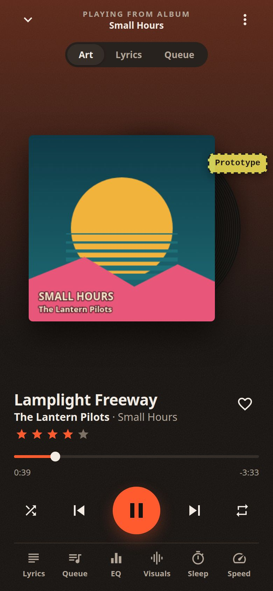
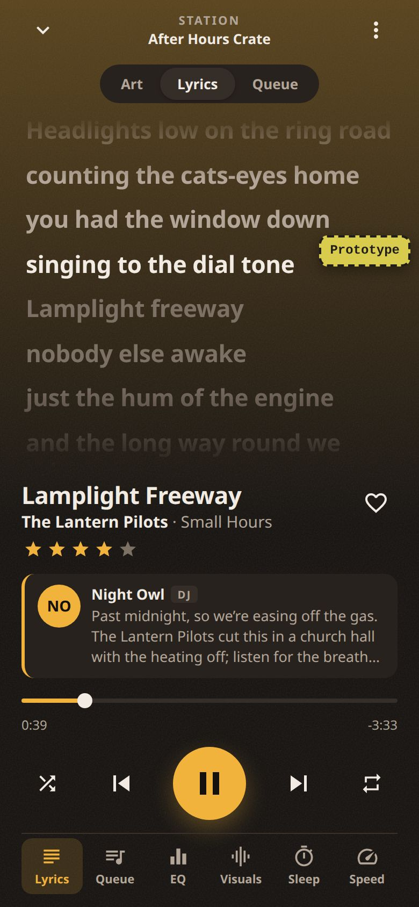
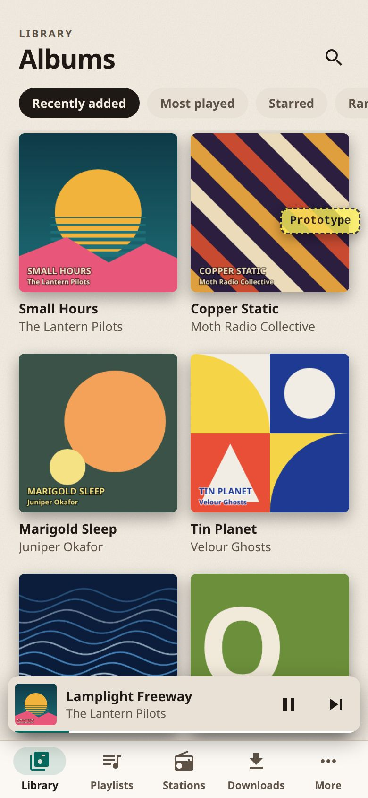
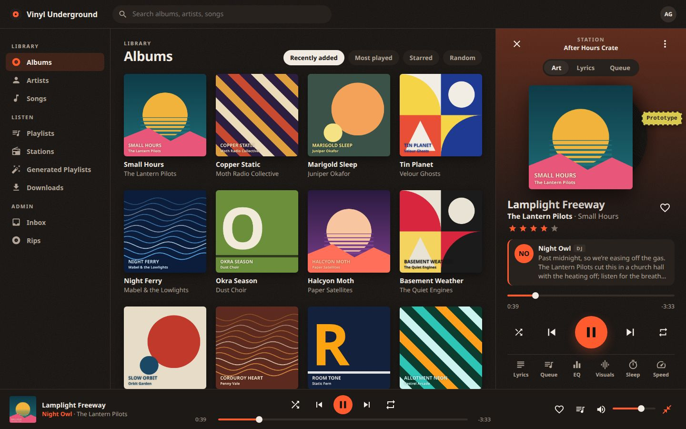

# Vinyl Underground

Vinyl Underground is a modified fork of [Navidrome](https://github.com/navidrome/navidrome) v0.64.2 (© Deluan Quintão and contributors, GPL-3.0). Forked on 2026-11-20 and modified since; see git history.

A self-hosted music server for a small household's own Library, with offline Downloads on your phone, AI-generated Playlists from a local LLM, and Stations hosted by DJ personas.

> [!WARNING]
> **Private networks only.** Vinyl Underground is a hard fork that never takes changes from Navidrome, **including security fixes** ([ADR-0001](docs/adr/0001-hard-fork-navidrome.md)). It is not hardened for the public internet. Run it only where your own devices can reach it, such as a [Tailscale](https://tailscale.com) tailnet. Never forward a port to it, put it behind a public reverse proxy, or use `tailscale funnel`.

## What it does

- Streams your Library to a browser or the installed web app (PWA). Phones get Opus at about 160 kbps (MP3 in Safari on an iPhone); desktops get the original File.
- Each Listener has their own login, favorites, ratings, play counts, history and Playlists. Playlists are private by default and read-only when shared.
- Downloads: albums and Playlists saved on the phone for offline playback, kept up to date when the app is online.
- Generated Playlists: type a Prompt ("rainy Sunday 90s indie") and a local LLM picks real Tracks from your Library. Optional.
- Stations: an endless queue hosted by a DJ persona, shaped by your skips and an optional Theme.
- The Inbox: new music, uploaded, copied in or ripped from a web page, reviewed by the admin and then promoted into the Library. Optional.

The plan is in [`docs/design.md`](docs/design.md), the vocabulary in [`GLOSSARY.md`](GLOSSARY.md), the key decisions in [`docs/adr/`](docs/adr/), and the work is tracked in this repo's issues. Capitalised terms (Library, File, Track, Listener, Station…) have precise meanings there.

## What the player will look like

> [!NOTE]
> These are screenshots of the [UI refresh prototype](prototypes/ui-refresh/), not the app as it is today. They show the planned look: the Now Playing view, Slate and cream themes, a Teal accent and DJ Blurbs. It is being built in [#90](https://github.com/CrimsonCowLabs/vinyl-underground/issues/90)–[#101](https://github.com/CrimsonCowLabs/vinyl-underground/issues/101).

<p>
  
  
  
</p>



## How it's put together

Vinyl Underground is opinionated. It is built for one household on one private network, and it leans on a handful of outside tools rather than reinventing them:

| Tool | What it's used for | Needed? | Where it's covered |
|---|---|---|---|
| [Navidrome](https://github.com/navidrome/navidrome) v0.64.2 | The base: scanning, Listeners, streaming, transcoding, Playlists, the Subsonic API, the React UI. Forked once and never synced again | Built in | [ADR-0001](docs/adr/0001-hard-fork-navidrome.md), [ADR-0003](docs/adr/0003-extend-legacy-navidrome-ui.md) |
| [Docker](https://docs.docker.com/engine/install/) + Compose | Runs the app (and, for the cleanup tools, beets) | Yes | [`deploy/README.md`](deploy/README.md) |
| [Tailscale](https://tailscale.com/kb/1017/install) | The private network, and HTTPS through `tailscale serve`, which the installable web app and Downloads need | Yes | [Step 5](#5-serve-it-over-https-with-tailscale), [ADR-0006](docs/adr/0006-offline-downloads-in-the-pwa.md) |
| A NAS over SMB/CIFS (`cifs-utils`) | Where the Library lives, mounted read-only. SMB1 (`vers=1.0`) works for old NAS devices | Or a local folder | [Step 1](#1-mount-the-music-share-read-only) |
| [ffmpeg](https://ffmpeg.org) | Transcoding to Opus for phones and Downloads | In the image | [ADR-0007](docs/adr/0007-phone-streams-opus-by-default.md) |
| [Ollama](https://ollama.com) (or llama.cpp, LM Studio, any OpenAI-compatible API) | A small local LLM (~4B, e.g. `qwen3.5:4b-q4_K_M`) for Generated Playlists, Station Themes and DJ Blurbs | Optional | [LLM](#llm-generated-playlists-and-station-themes), [runbook §11](deploy/README.md#11-generated-playlists-optional-llm), [ADR-0004](docs/adr/0004-llm-ranks-library-candidates-never-invents-tracks.md) |
| [Last.fm](https://www.last.fm/api), Deezer, ListenBrainz | Artist and album info, and similar artists for Generated Playlists. Scrobbling is removed | On by default | [Outside lookups](#lastfm-and-other-outside-lookups) |
| [MusicBrainz](https://musicbrainz.org) | Album and year proposals for new music in the Inbox | On by default | [`docs/design.md`](docs/design.md#inbox-and-rips-designed-2026-11-20) |
| [Cover Art Archive](https://coverartarchive.org) | Album covers for albums tagged with a MusicBrainz release ID and no cover of their own, ahead of Last.fm | On by default | [Outside lookups](#lastfm-and-other-outside-lookups) |
| [yt-dlp](https://github.com/yt-dlp/yt-dlp) | Rips: fetching audio from YouTube and other sites into the Inbox. The app downloads and updates it itself | Optional, off by default | [Ripping](#inbox-uploads-ripping-and-promote), [runbook §10](deploy/README.md#10-rip-a-video-a-playlist-or-an-album-into-the-inbox) |
| [jdupes](https://codeberg.org/jbruchon/jdupes), Python 3.10+ | Finding Duplicates to move into Quarantine | For the cleanup | [Step 2](#2-move-duplicates-into-quarantine) |
| [beets](https://beets.io), with [Chromaprint/AcoustID](https://acoustid.org), [Last.fm genres](https://beets.readthedocs.io/en/stable/plugins/lastgenre.html) and the [Cover Art Archive](https://coverartarchive.org) | Retagging the whole Library from MusicBrainz, and giving every album a cover. Runs in Docker | Optional | [Library cleanup](#clean-up-the-library) |

**The liberties it takes**, so you can decide whether they suit you:

- **No upstream security fixes, ever.** It is a hard fork, so it must only be reachable from your own devices ([ADR-0001](docs/adr/0001-hard-fork-navidrome.md)).
- **The Library is read-only to the app**, with one exception: a single `Vinyl Underground/` folder that Promote writes to ([ADR-0008](docs/adr/0008-app-writes-to-one-dedicated-library-folder.md)). There is no dedupe code. Duplicates are moved off the drive instead ([ADR-0002](docs/adr/0002-quarantine-duplicates-instead-of-in-app-dedupe.md)).
- **The cleanup tools do rewrite your Files.** The retag writes new tags into every File it matches, and the cover tool embeds art. Both run only by hand, through a temporary writable mount, ask or dry-run first, and the cover tool can back up and restore.
- **The LLM never picks music you don't own.** It turns a Prompt into filters, and the server builds the candidates from the Library. The LLM only ranks and trims them and writes Blurbs ([ADR-0004](docs/adr/0004-llm-ranks-library-candidates-never-invents-tracks.md)).
- **Artist and album names leave the machine** for Last.fm and MusicBrainz lookups, unless you turn them off, and the retag sends audio fingerprints to AcoustID. What you play never does: scrobbling is removed.
- **Phones get Opus by default**, detected from the User-Agent, with no per-device setup ([ADR-0007](docs/adr/0007-phone-streams-opus-by-default.md)).
- **Stations are personal, not a live broadcast.** There's no Icecast and no shared timeline ([ADR-0005](docs/adr/0005-stations-are-personal-not-live-broadcast.md)).
- **It extends Navidrome's old UI stack** (React 17, react-admin 3, MUI v4) rather than rewriting it ([ADR-0003](docs/adr/0003-extend-legacy-navidrome-ui.md)).

## What's been built

Everything below is done and merged. Each item links to its issue, where the details and the discussion are. [`docs/design.md`](docs/design.md) describes how each part works.

**Foundation**
- Mounted the NAS read-only, forked and rebranded Navidrome, and deployed it over Tailscale HTTPS for two Listeners ([#1](https://github.com/CrimsonCowLabs/vinyl-underground/issues/1), [#3](https://github.com/CrimsonCowLabs/vinyl-underground/issues/3), [#4](https://github.com/CrimsonCowLabs/vinyl-underground/issues/4)).
- A self-hoster README with example config ([#18](https://github.com/CrimsonCowLabs/vinyl-underground/issues/18)), and a multi-arch (amd64 + arm64) image published to GHCR on each release ([#19](https://github.com/CrimsonCowLabs/vinyl-underground/issues/19), [`docs/releasing.md`](docs/releasing.md)).

**Listening**
- Phones stream Opus at ~160 kbps (MP3 on iPhone Safari), with a per-Listener override ([#5](https://github.com/CrimsonCowLabs/vinyl-underground/issues/5)).
- Playlists can be shared read-only and copied by other Listeners ([#6](https://github.com/CrimsonCowLabs/vinyl-underground/issues/6)).

**Downloads, for offline play** ([ADR-0006](docs/adr/0006-offline-downloads-in-the-pwa.md))
- Download a Playlist and play it offline ([#7](https://github.com/CrimsonCowLabs/vinyl-underground/issues/7)). A downloaded Playlist stays in sync when the app is online ([#8](https://github.com/CrimsonCowLabs/vinyl-underground/issues/8)).
- Album Downloads, a storage meter, and offline shuffle ([#9](https://github.com/CrimsonCowLabs/vinyl-underground/issues/9)).
- Badges showing what's on this device: on album grid tiles, in the album table, on the Playlist list and on songs ([#67](https://github.com/CrimsonCowLabs/vinyl-underground/issues/67), [#68](https://github.com/CrimsonCowLabs/vinyl-underground/issues/68), [#69](https://github.com/CrimsonCowLabs/vinyl-underground/issues/69), [#70](https://github.com/CrimsonCowLabs/vinyl-underground/issues/70)).

**Generated Playlists** (needs an LLM; [ADR-0004](docs/adr/0004-llm-ranks-library-candidates-never-invents-tracks.md))
- Type a Prompt, preview the Playlist, save it ([#10](https://github.com/CrimsonCowLabs/vinyl-underground/issues/10)). Regenerate it later from its stored Prompt ([#11](https://github.com/CrimsonCowLabs/vinyl-underground/issues/11)).
- Last.fm similar artists widen the candidates when the Library's genre tags are sparse ([#12](https://github.com/CrimsonCowLabs/vinyl-underground/issues/12)).

**Stations and DJs** ([ADR-0005](docs/adr/0005-stations-are-personal-not-live-broadcast.md))
- Start a Station with a built-in DJ (Night Owl, The Crate Digger, Sunny), with rule-based selection that needs no LLM ([#13](https://github.com/CrimsonCowLabs/vinyl-underground/issues/13)).
- Skips make a Station play that Track and artist a little less, fading over ~30 days, without touching ratings ([#14](https://github.com/CrimsonCowLabs/vinyl-underground/issues/14)).
- With an LLM: the DJ's persona and an optional Theme ("late-night drive") choose the Tracks, selected ahead so playback never waits ([#15](https://github.com/CrimsonCowLabs/vinyl-underground/issues/15)), and the DJ writes on-screen Blurbs between Tracks ([#16](https://github.com/CrimsonCowLabs/vinyl-underground/issues/16)).
- Listeners create their own private DJs from a name and a personality ([#17](https://github.com/CrimsonCowLabs/vinyl-underground/issues/17)).

**New music: the Inbox, Rips and Promote** ([ADR-0008](docs/adr/0008-app-writes-to-one-dedicated-library-folder.md))
- Files dropped into the Inbox folder become playable for the admin ([#27](https://github.com/CrimsonCowLabs/vinyl-underground/issues/27)). Uploads and dropped Files get review cards ([#35](https://github.com/CrimsonCowLabs/vinyl-underground/issues/35)).
- Rip a single video, a playlist or an album with yt-dlp ([#28](https://github.com/CrimsonCowLabs/vinyl-underground/issues/28), [#30](https://github.com/CrimsonCowLabs/vinyl-underground/issues/30)), with a "Ripped" badge from the File's `SOURCE` tag ([#29](https://github.com/CrimsonCowLabs/vinyl-underground/issues/29)). yt-dlp keeps itself up to date ([#31](https://github.com/CrimsonCowLabs/vinyl-underground/issues/31)), and the app warns before ripping something already in the Library ([#32](https://github.com/CrimsonCowLabs/vinyl-underground/issues/32)).
- Review each batch's tags, with MusicBrainz proposals for album and year, then Discard or Promote ([#33](https://github.com/CrimsonCowLabs/vinyl-underground/issues/33), [#34](https://github.com/CrimsonCowLabs/vinyl-underground/issues/34)).
- Promote moves reviewed Files onto the NAS, keeping each Track's favorites, play counts and Playlist entries ([#36](https://github.com/CrimsonCowLabs/vinyl-underground/issues/36)).

**Corrections, fixing tags in the app** (the share stays read-only)
- Admins rename a misspelled Artist from its page. The fix is kept in the app, applies in every client and to Files added later, keeps favorites, play counts and Playlists, and can be undone from the Corrections page ([#122](https://github.com/CrimsonCowLabs/vinyl-underground/issues/122)).

**Library cleanup** (tools run by hand, in [`contrib/library-cleanup`](contrib/library-cleanup/README.md))
- Merge folder names that differ only by letter case, which confuse case-insensitive SMB1 NAS devices, and move Duplicates into Quarantine ([#2](https://github.com/CrimsonCowLabs/vinyl-underground/issues/2)).
- Also quarantine audio-identical Duplicates whose tags differ ([#53](https://github.com/CrimsonCowLabs/vinyl-underground/issues/53)), and the weaker copy of albums held twice ([#54](https://github.com/CrimsonCowLabs/vinyl-underground/issues/54)).
- A Library health report from the app's database ([#52](https://github.com/CrimsonCowLabs/vinyl-underground/issues/52)).
- Retag the Library from MusicBrainz with beets ([#55](https://github.com/CrimsonCowLabs/vinyl-underground/issues/55)), then give every album a cover, with `run-covers.sh` for a dry run, backups and a restore ([#56](https://github.com/CrimsonCowLabs/vinyl-underground/issues/56)).

## Set it up with an AI assistant

The setup touches your network, your NAS and `sudo`, so it is easy to get a step slightly wrong. An AI coding assistant such as [Claude Code](https://claude.com/claude-code), run on the host in a clone of this repo, can walk you through it. Paste this prompt and answer its questions:

````text
Help me set up Vinyl Underground, a self-hosted music server, on this Linux host. You are in a
clone of its repo.

First read README.md, deploy/README.md, GLOSSARY.md and the ADRs in docs/adr/, and
contrib/library-cleanup/README.md if I want the Library cleaned up. Follow the README's
"Self-hosting" steps in order, using the runbook for detail. Don't invent steps or settings the
docs don't describe; if the docs and this host disagree, stop and tell me.

Before you start, check what is already in place (Docker and Compose, Tailscale and whether it
is logged in, cifs-utils, existing mounts in /etc/fstab and /proc/mounts, an existing deploy/.env)
and ask me for what you can't find out:
- where my music is: the NAS address, share name and SMB version (old NAS devices need
  vers=1.0), or a local folder;
- the Tailscale host name I'm happy to have published in Certificate Transparency logs;
- which optional features I want: an LLM (on which machine, which model), ripping, Promote,
  Last.fm lookups (and whether I mind names leaving the machine);
- whether I want the Library cleanup (Duplicates, and optionally the MusicBrainz retag and covers).

Rules:
- Ask before every sudo command, every change to /etc/fstab, every mount, and anything that
  writes to the music share. Show me the exact command first.
- Keep passwords out of the repo, the shell history and your replies: the NAS password goes in a
  root-only credentials file that I edit myself with sudoedit, and settings in the gitignored
  deploy/.env only.
- The app is for private networks only. Never use `tailscale funnel`, forward a port, or put it
  behind a public proxy.
- For anything that changes Files on the share, run the dry run or plan first, show me the
  result, and only go ahead when I say so. Prefer the tools' backup options.
- Check each step the way the docs do (the mount is read-only, "Scan completed" in the logs,
  `tailscale serve status`, the HTTPS URL opens) before moving on, and tell me what you checked.
- At the end, summarise what was set up, every value you put in deploy/.env (but no secrets), and
  what I still have to do by hand (creating the admin in the browser, installing the app on a
  phone, any Full Scan).
````

The assistant can't create the admin account or install the app on a phone for you; those happen in the browser.

## Self-hosting

You need:

- A Linux host on your tailnet, with Docker (and its Compose plugin), Tailscale, and `cifs-utils` for a network share.
- Your music on a share the host can mount, or a local folder.
- Optional: a machine that can run an LLM (see [LLM](#llm-generated-playlists-and-station-themes)).

Clone this repo on the host (`git clone https://github.com/CrimsonCowLabs/vinyl-underground.git`); paths below are relative to the clone. The steps set up the host once. [`deploy/README.md`](deploy/README.md) is the full runbook for the stack itself: the settings, the first-scan checks, Listeners, phones, the Inbox and Promote. All its commands run from `deploy/`.

### 1. Mount the music share read-only

The app never writes to the Library ([ADR-0002](docs/adr/0002-quarantine-duplicates-instead-of-in-app-dedupe.md)); the one exception is an optional folder for Promote ([ADR-0008](docs/adr/0008-app-writes-to-one-dedicated-library-folder.md), [below](#inbox-uploads-ripping-and-promote)). Mount the share on the host read-only, and the container binds it read-only again at `/music`.

A credentials file, readable only by root, keeps the password out of `/etc/fstab`:

```bash
sudo install -d -m 700 /etc/samba-creds
sudo install -m 600 /dev/null /etc/samba-creds/nas
sudoedit /etc/samba-creds/nas    # username=<nas-user> and password=<nas-password>, one per line
sudo install -d -m 555 /mnt/music
```

Then one line in `/etc/fstab` (`nas-host` and `music` are your NAS and share):

```
//nas-host/music  /mnt/music  cifs  ro,vers=3.0,credentials=/etc/samba-creds/nas,uid=1000,gid=1000,iocharset=utf8,noserverino,_netdev,nofail  0  0
```

- **Older NAS devices** (such as old Buffalo LinkStations) speak only SMB1: use `vers=1.0` instead of `vers=3.0`. The host's kernel must still allow SMB1; `grep CONFIG_CIFS_ALLOW_INSECURE_LEGACY /boot/config-$(uname -r)` must show `=y`. SMB1 is old and insecure, which is one more reason to keep the NAS on a private network.
- `uid`/`gid` give the Files to the user the app runs as (`VU_UID`/`VU_GID`, `1000` by default), so it can read them.
- `iocharset=utf8` keeps accented names intact. `noserverino` avoids the inode-number problems of older SMB servers.
- `_netdev` waits for the network at boot. `nofail` lets the host boot when the NAS is away.

Mount it and check that it is read-only:

```bash
sudo mount /mnt/music
findmnt -no OPTIONS /mnt/music | tr , '\n' | grep -x ro    # prints "ro"
touch /mnt/music/.vu-check                                 # must fail: "Read-only file system"
```

Start the app only once the share is mounted. If the app starts without it, it sees an empty Library and marks its Tracks missing; they come back, with their favorites and play counts, at the next scan once the share is mounted again.

### 2. Move Duplicates into Quarantine

The app has no dedupe code ([ADR-0002](docs/adr/0002-quarantine-duplicates-instead-of-in-app-dedupe.md)): every File becomes a Track, so a Duplicate such as `Song 1.mp3` shows up twice. Before the first scan, move byte-identical Duplicates into a `_Quarantine/` folder on the share, which the scanner skips. You need `jdupes` and Python 3.10+ on the host, and a temporary writable mount of the share beside the read-only one (same options, with `rw` instead of `ro`). On a case-insensitive NAS (old SMB1 devices), first [merge names that differ only by letter case](contrib/library-cleanup/README.md#recipe-merge-names-that-differ-only-by-case), as `jdupes` can't be trusted on them.

```bash
sudo install -d /mnt/music-rw
sudo mount -t cifs //nas-host/music /mnt/music-rw \
  -o rw,vers=3.0,credentials=/etc/samba-creds/nas,uid=$(id -u),gid=$(id -g),iocharset=utf8,noserverino
cd contrib/library-cleanup
PLANS=~/library-plans; mkdir -p "$PLANS"    # any folder outside the share
```

1. **List the Duplicate sets.** `jdupes` with no action flag changes nothing, so it runs on the read-only mount. Leave out `_Quarantine/` and the NAS's recycle bin, if it has one on the share (`trashbox/` on a LinkStation):

   ```bash
   (cd /mnt/music && find . -mindepth 1 -maxdepth 1 -type d ! -name _Quarantine ! -name trashbox -printf '%P\0' \
     | xargs -0 jdupes -r -S) > "$PLANS/jdupes.txt"
   python3 scan.py /mnt/music > "$PLANS/scan.tsv"
   python3 dupes.py "$PLANS/jdupes.txt" "$PLANS/scan.tsv" --root /mnt/music > "$PLANS/dupes.tsv"
   ```

2. **Review the plan.** Each line of `dupes.tsv` moves one File to the same path under `_Quarantine/` and names the identical File that stays. Delete a line to keep both.

3. **Dry run first, then apply:**

   ```bash
   python3 apply.py /mnt/music-rw "$PLANS/dupes.tsv" --dry-run
   python3 apply.py /mnt/music-rw "$PLANS/dupes.tsv"
   ```

   `apply.py` checks each File is still byte-identical to the one kept before it moves it, and gives `_Quarantine/` a `.ndignore` so the scanner skips it. It can be stopped and re-run.

4. **Check:** repeat step 1; `dupes.py` must report `0 Duplicates to quarantine`. Give the recycle bin a `.ndignore` too (`touch /mnt/music-rw/trashbox/.ndignore`), or empty it, as Files removed over SMB land there. Then `sudo umount /mnt/music-rw`.

This is the short form of the [full recipe](contrib/library-cleanup/README.md#recipe-quarantine-duplicates), which explains the plan's format and which File is kept. The passes after it there, for Duplicates whose tags differ and for albums held twice, are worth running too. Re-run them whenever new Duplicates may have arrived.

### 3. Get the app

Run the rest from `deploy/` (from the clone's root: `cd deploy`). [`deploy/docker-compose.yml`](deploy/docker-compose.yml) and [`deploy/.env.example`](deploy/.env.example) hold no personal values: every setting has a default, and your own values go in a gitignored `deploy/.env`.

- **Build from source** (the default): leave `VU_IMAGE` unset, and add `--build` to `docker compose up` in the next step. The first build takes several minutes.

- **Published image** (amd64 and arm64), once a release is published ([the image's versions](https://github.com/CrimsonCowLabs/vinyl-underground/pkgs/container/vinyl-underground)); until then, build from source. Set the version in `.env` and pull it:

  ```bash
  echo 'VU_IMAGE=ghcr.io/crimsoncowlabs/vinyl-underground:<version>' >> .env
  docker compose pull vinyl-underground
  ```

  Tags are the full version (`1.2.3`, without the `v`), the minor line (`1.2`), and `latest` for the newest stable release. How releases are cut is in [`docs/releasing.md`](docs/releasing.md).

The defaults expect the Library at `/mnt/music` and keep the database in `deploy/data` and the Inbox in `deploy/inbox`. To change those or any app setting, see [Configure](deploy/README.md#2-configure).

### 4. Start it and check the first scan

```bash
docker compose up -d            # or: docker compose up -d --build
docker compose logs -f vinyl-underground
```

The first scan starts on its own; wait for `Scan completed`. Then check it picked up no Quarantine Files and no Duplicates, as in [the runbook](deploy/README.md#4-start-the-app-and-run-the-first-scan).

### 5. Serve it over HTTPS with Tailscale

The web app needs HTTPS: without it the browser won't register its service worker, so it can't be installed and Downloads can't work ([ADR-0006](docs/adr/0006-offline-downloads-in-the-pwa.md)). Docker publishes the app on `127.0.0.1:4533` only, and `tailscale serve` adds HTTPS on the tailnet:

1. In the [Tailscale admin console](https://login.tailscale.com/admin/dns), under **DNS**, turn on **MagicDNS** and **HTTPS Certificates**. Each machine's name is published in the public Certificate Transparency logs when it gets a certificate, so pick a host name you don't mind being public.
2. On the host:

   ```bash
   sudo tailscale serve --bg 4533    # or your VU_PORT
   tailscale serve status            # https://<host>.<your-tailnet>.ts.net proxying to http://127.0.0.1:4533
   ```

3. Open `https://<host>.<your-tailnet>.ts.net` from any device on the tailnet and create the admin.

`--bg` keeps the setting across reboots. Use `serve`, never `funnel`. No base URL setting is needed. The checks, the second Listener and installing the app on a phone are in [the runbook](deploy/README.md#5-serve-it-over-https-with-tailscale-serve).

### Updating

```bash
git pull
# published image: change VU_IMAGE in .env, then
docker compose pull vinyl-underground && docker compose up -d
# built from source:
docker compose up -d --build
```

The database and settings live in `deploy/data`, so they survive updates. Backups are in [the runbook](deploy/README.md#updating).

## Optional features

### LLM: Generated Playlists and Station Themes

The app talks to any OpenAI-compatible endpoint: Ollama, llama.cpp, LM Studio or a hosted API. Set both lines in `deploy/.env`, then `docker compose up -d`:

```bash
ND_LLM_BASEURL=http://llm-host.example-tailnet.ts.net:11434   # one with no path gets /v1 added
ND_LLM_MODEL=qwen3.5:4b-q4_K_M
```

- **The model has no default.** Both settings are empty out of the box, and with either one empty the LLM features stay hidden.
- **A machine on the tailnet needs its full MagicDNS name** (`llm-host.example-tailnet.ts.net`, or its tailnet IP). Docker's DNS inside the container doesn't add the tailnet's search domain, so a short name like `llm-host` that works on the host fails in the app with "bad address".
- `ND_LLM_APIKEY` is for endpoints that need a key (Ollama doesn't). `ND_LLM_TIMEOUT` (default `3m`) bounds one call, and `ND_LLM_CONNECTTIMEOUT` (default `5s`) how long to wait before reporting the LLM unavailable.
- With Ollama, use a GGUF build of the model; its MLX builds refuse the JSON-schema replies the app asks for.

**Without an LLM** everything else works: streaming, Downloads, Playlists made by hand, the Inbox, and Stations, whose DJs then pick Tracks by rule, still shaped by your skips. Only the AI parts are hidden: the **Generate** and **Regenerate** buttons and the Station's **Theme** field. If a configured LLM can't be reached (its host is asleep, say), the Listener sees "AI unavailable" after a few seconds instead of a hang.

Running Ollama on another machine, or on the same host with the stack's `ollama` profile, and measured timings, are in [the runbook](deploy/README.md#11-generated-playlists-optional-llm).

### Last.fm and other outside lookups

Outside metadata lookups are on, as in Navidrome: the app fetches artist info, album info and similar artists from Last.fm (with `ND_LASTFM_APIKEY` set), Deezer and ListenBrainz. **This sends artist and album names from your Library to Last.fm** (and to those services). Generated Playlists use the similar artists to find more Tracks in the Library when its genre tags are sparse; if Last.fm can't be reached, they are built from the Library's own tags alone. Set `ND_ENABLEEXTERNALSERVICES=false` to turn all outside lookups off.

**Album covers** come from the album's own folder and embedded art first. An album with neither gets one from the [Cover Art Archive](https://coverartarchive.org) when its Files carry a MusicBrainz release ID (as Picard and the [retag](#clean-up-the-library) write): the front cover of that exact release, else of another release of the same album. Only then is Last.fm asked, by name and artist, plus the MusicBrainz ID when there is one. The order is `ND_COVERARTPRIORITY`, default `cover.*, folder.*, front.*, embedded, coverartarchive, external`: move or drop `coverartarchive` to change where the archive is asked, and `external` for Last.fm. A `ND_COVERARTPRIORITY` you set before this existed has no `coverartarchive`, so it keeps working exactly as before until you add it. Its lookups go at most one a second, send only the MusicBrainz IDs, and name the client as `VinylUnderground/<version>` and nothing more. Changing the order applies to covers resolved from then on; `navidrome artwork reprocess --all` re-resolves the rest.

Scrobbling stays off: the app never sends what you play to Last.fm, and it doesn't offer to link a Last.fm account. Details are in [the runbook](deploy/README.md#similar-artists-from-lastfm).

### Inbox, uploads, ripping and Promote

New music never goes straight into the read-only Library. It lands in the **Inbox** (`deploy/inbox` on the host, `/inbox` in the container), which the app scans as a second library that only the admin sees. The Inbox is set up by default.

- **Uploads and dropped Files:** the admin's **Rips** page has an **Upload Files** button (mp3, m4a, opus, ogg, flac, aiff or wav, up to 500 MB each), and Files copied straight into the Inbox folder are picked up too. Each batch gets a review card, to fix its tags and then **Promote all** or **Discard**. See [the runbook](deploy/README.md#9-add-new-music-through-the-inbox).
- **Ripping** fetches the audio of a web page (usually a YouTube or YouTube Music video, playlist or album) into the Inbox with [yt-dlp](https://github.com/yt-dlp/yt-dlp). It is **off by default**: set `ND_RIPPING_ENABLED=true` in `deploy/.env` and run `docker compose up -d`. The Rip runs in the background and lands on a review card. See [the runbook](deploy/README.md#10-rip-a-video-a-playlist-or-an-album-into-the-inbox).
- **Promote** moves reviewed Files from the Inbox into the Library, keeping each Track's favorites, play counts and Playlist entries. The app may write to exactly one folder of the share, `Vinyl Underground/` ([ADR-0008](docs/adr/0008-app-writes-to-one-dedicated-library-folder.md)): create it on the share, give just that folder a second, read-write CIFS mount on the host (with `vers=1.0` for an SMB1 NAS, as above), and turn on `docker-compose.promote.yml` in `.env`. Promote is off until then. See [the runbook](deploy/README.md#12-promote-inbox-tracks-to-the-nas-optional).

**You are responsible for what you download.** Only rip what you have the right to copy, and check the terms of the site you rip from and the law where you live. Vinyl Underground and its authors don't check what you rip and accept no responsibility for it.

## Clean up the Library

Every File becomes a Track, exactly as it is tagged, so a messy Library shows up messy. [`contrib/library-cleanup`](contrib/library-cleanup/README.md) has the tools that cleaned up the reference Library (about 23,000 Files on an SMB1 NAS). They all run by hand through a temporary writable mount, plan or dry-run first, and leave the app's read-only mount alone. In the order to run them:

| Step | Tool | What it fixes |
|---|---|---|
| 0 | [`health.py`](contrib/library-cleanup/README.md#library-health-report) | Measures the Library from the app's database: no year, no album, no cover, Duplicates, albums held twice. Run it before and after each step |
| 1 | [`casemerge.py`](contrib/library-cleanup/README.md#recipe-merge-names-that-differ-only-by-case) | Folders whose names differ only by case (`ATB` and `Atb`), which a case-insensitive NAS silently merges in listings. Only needed on such a NAS |
| 2 | [`dupes.py`](contrib/library-cleanup/README.md#recipe-quarantine-duplicates) with jdupes | Byte-identical Duplicates, moved into Quarantine ([step 2 above](#2-move-duplicates-into-quarantine) is the short form) |
| 3 | [`audiodupes.py`](contrib/library-cleanup/README.md#recipe-quarantine-duplicates-whose-tags-differ) | Duplicates whose audio is identical but whose tags differ (`Song 1.mp3` beside `Song.mp3`) |
| 4 | [`heldtwice.py`](contrib/library-cleanup/README.md#recipe-quarantine-the-weaker-copy-of-albums-held-twice) | The same album in two folders: the weaker copy's shared Tracks go to Quarantine |
| 5 | [`beets/retag.sh`](contrib/library-cleanup/README.md#recipe-retag-the-library-from-musicbrainz) | Missing years, track numbers, wrong discs and albums: beets matches each album against MusicBrainz (with audio fingerprints), asks you to approve it, and writes the tags in place. Takes many hours |
| 6 | [`beets/run-covers.sh`](contrib/library-cleanup/README.md#all-in-one-run-coverssh) | Albums with no cover: keeps a good one the album has, else fetches one from the Cover Art Archive (by the retag's MusicBrainz IDs), fanart.tv, iTunes or Wikipedia, saves `cover.jpg` and embeds it. Needs step 5 first |

After each step that changes the share, unmount the writable mount and run a Full Scan in the app. Re-run steps 2 to 6 when new music arrives outside the Inbox.

## Documentation

| Document | What's in it |
|---|---|
| [`deploy/README.md`](deploy/README.md) | The runbook: every setting, the first scan, Listeners, phones, the Inbox, ripping, the LLM, Promote, updates and backups |
| [`contrib/library-cleanup/README.md`](contrib/library-cleanup/README.md) | The Library cleanup recipes and the health report |
| [`docs/design.md`](docs/design.md) | The design, feature by feature, with how each part works |
| [`docs/adr/`](docs/adr/) | Why the big decisions went the way they did |
| [`GLOSSARY.md`](GLOSSARY.md) | What Library, File, Track, Duplicate, Listener, Station, DJ, Download, Inbox, Promote and the other terms mean here |
| [`docs/releasing.md`](docs/releasing.md) | How releases and images are cut |
| [`deploy/.env.example`](deploy/.env.example) | Every setting, at its default |

## Development

Building from source needs Go 1.27 (with cgo, for SQLite), Node 24 and ffmpeg. The build and test commands are in the [`Makefile`](Makefile) (`make setup`, `make dev`, `make test`), as in Navidrome.

## License and credit

Vinyl Underground is a modified fork of [Navidrome](https://github.com/navidrome/navidrome) v0.64.2, © Deluan Quintão and contributors. Like Navidrome, it is free software under the [GNU General Public License v3.0](LICENSE): you may use, change and share it under that license's terms, and it comes with no warranty. Navidrome's copyright notices are kept, and changes since the fork are in the git history. Vinyl Underground is not made or endorsed by the Navidrome project; please don't report its problems to them.
