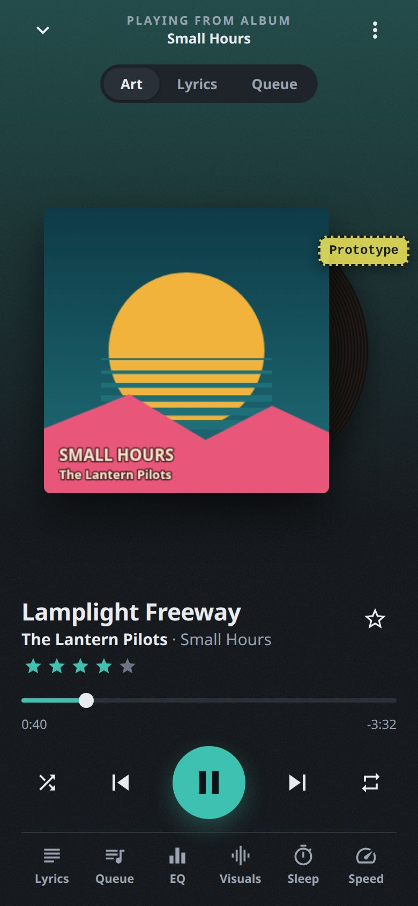
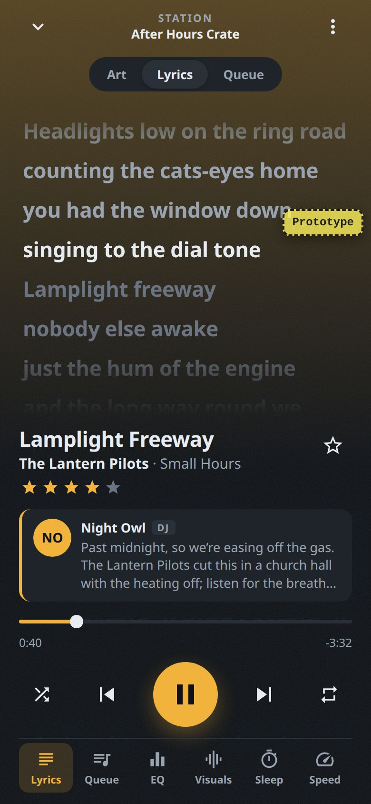
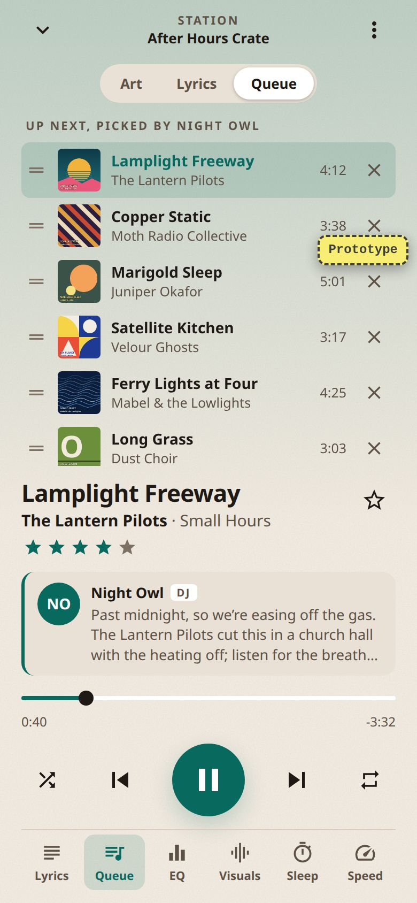
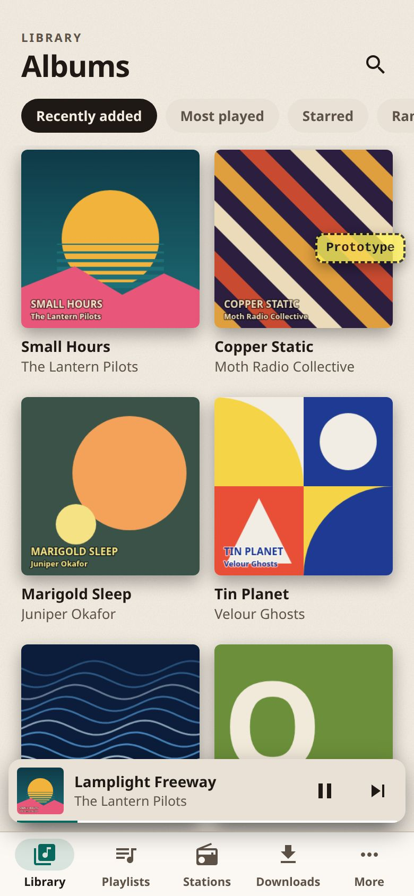
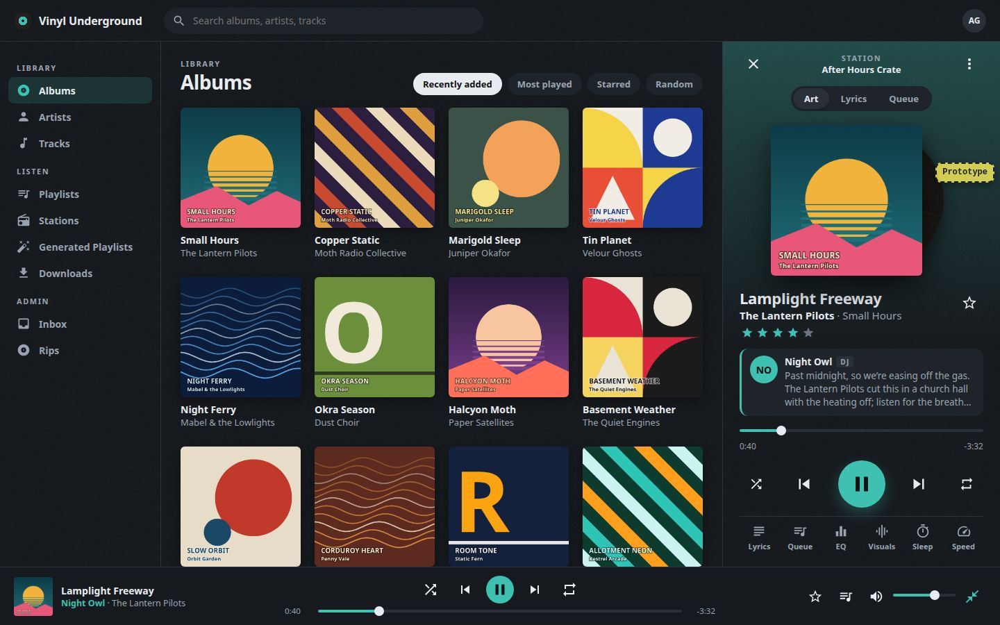
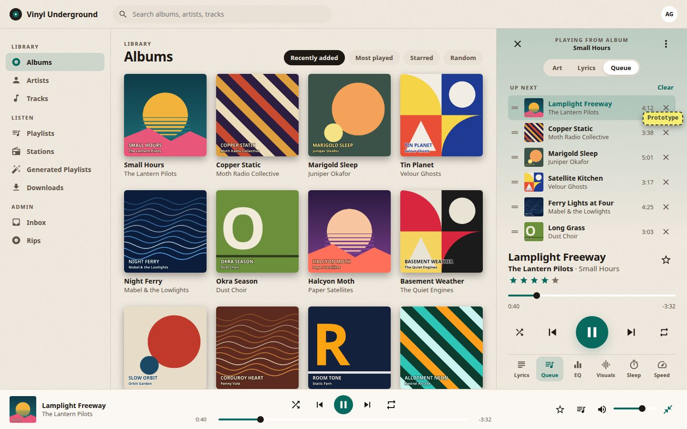

# UI refresh prototype (throwaway)

A throwaway prototype for [#88](https://github.com/CrimsonCowLabs/vinyl-underground/issues/88): the
new look (a slate dark theme, a warm cream light theme) and the Now Playing layout, to react to on a real phone and in a desktop
browser before #90, #91, #92, #98, #99, #100 and #101 build it for real.

**It is throwaway.** It is plain HTML, CSS and JS with no build step, it sits outside `ui/` so the
Vite build and the Go embed (`ui/build`, `resources/`) never see it, and it gets deleted (or left on
its branch) once the review's decisions are written into the "UI refresh" section of
`docs/design.md`. Nothing here is meant to be copied into `ui/src` as is.

Everything is fake: the albums, bands, lyrics and DJ are made up, the covers are drawn on a canvas,
and there is no audio. The seek bar moves, buttons toggle and the queue responds, but nothing plays.

## Opening it

- **On a desktop:** open `index.html` straight from the file system. No server is needed.
- **On a phone, from your machine:** serve the folder and open it over the LAN or Tailscale:

  ```sh
  cd prototypes/ui-refresh
  python3 -m http.server 8088
  # then on the phone: http://<machine's LAN or Tailscale name>:8088/
  ```

- **On a phone, from GitHub:** the repo is public, so a static-HTML previewer can serve it straight
  from the branch, for example
  <https://htmlpreview.github.io/?https://github.com/CrimsonCowLabs/vinyl-underground/blob/ui-refresh-prototype/prototypes/ui-refresh/index.html>.
  (GitHub's own "Raw" view serves the file as text, so it won't render.)

On a phone-sized screen the phone framing fills the screen. Add it to the home screen for the
full-screen feel.

## What to try

The yellow **Prototype** tab on the right edge opens the controls. They are styled off-brand on
purpose so they don't read as part of the design.

| Control     | What it switches                                                                 |
| ----------- | -------------------------------------------------------------------------------- |
| Theme       | Dark or light variant                                                            |
| Accent      | 8 fixed accents, plus "From album art" (the rainbow swatch). ← and → cycle them  |
| Framing     | Phone (full-screen Now Playing, mini player, tab bar) or Desktop (side panel)    |
| Station     | Off, or a Station with the "Night Owl" DJ and a Blurb per Track                  |
| Now Playing | Closed (browse page with the mini player) or open                                |

The panel also shows the accent in use, the colour taken from the cover, and their contrast
ratios. The query string mirrors the controls, so a combination can be shared, for example
`index.html?theme=light&accent=art&frame=desktop&station=1&tab=lyrics`.

Things to look at:

- **Phone:** tap the mini player to open Now Playing, and the chevron to close it. Tapping the
  title, artist or album closes it too (and toasts where it would go).
- **Desktop:** the cover in the player bar, or the expand button on its right, docks and undocks
  the 400px panel. The album grid is pushed over, not covered. Narrow the window below 1000px and
  the panel becomes the full-screen view; below 720px the sidebar goes as well.
- **Art · Lyrics · Queue tabs:** "Lamplight Freeway" has synced lyrics (tap a line to seek),
  "Copper Static" has unsynced lyrics, and the rest say there are none. In Queue, tap a row to
  play it or × to remove it. The drag handles are only drawn, not wired.
- **Toolbar:** Lyrics and Queue switch tabs, EQ opens a sheet with presets, Visuals swaps the art
  for bars (and renames the tab), Sleep and Speed cycle through values and show them.
- **From album art:** press next and watch the accent fade to each cover's colour.

## Palette

Every colour is a CSS custom property in `styles.css`, so it maps straight onto an MUI v4 theme.
Body and secondary text, and every accent, pass WCAG AA for normal text (4.5:1). `--vu-text-3` is
only for large text and non-text marks, where AA asks for 3:1.

### Surfaces and text

**Dark is Slate**, a cool blue-grey, chosen in review over the original warm brown. The Prototype
panel's "Dark base" switch (or `?base=`) still offers Warm, Graphite (neutral grey) and Ink (true
black) for comparison; their values are in `styles.css`.

| Token            | MUI v4 theme key                         | Dark      | Light     | Used for                                         |
| ---------------- | ---------------------------------------- | --------- | --------- | ------------------------------------------------ |
| `--vu-bg`        | `palette.background.default`, theme-color | `#0F1216` | `#F3EDE4` | Page background, Now Playing                     |
| `--vu-surface`   | `palette.background.paper`               | `#161A1F` | `#FBF8F3` | Tab bar, player bar, sheets                      |
| `--vu-surface-2` | custom (e.g. `palette.vu.surface2`)      | `#1F242B` | `#E9E1D5` | Mini player, chips, search, DJ card, tab track   |
| `--vu-surface-3` | custom (e.g. `palette.vu.surface3`)      | `#2A3038` | `#FFFFFF` | Selected tab pill, slider track                  |
| `--vu-divider`   | `palette.divider`                        | `#2E343C` | `#D6CBBC` | Borders                                          |
| `--vu-text`      | `palette.text.primary`                   | `#E8ECF1` | `#1E1915` | Body text (15.8:1 dark, 15.0:1 light)            |
| `--vu-text-2`    | `palette.text.secondary`                 | `#9AA4B0` | `#5E5247` | Secondary text (7.4:1 dark, 6.5:1 light)         |
| `--vu-text-3`    | `palette.text.disabled`                  | `#6B7480` | `#7E7163` | Large text and marks only (4.0:1 dark, 4.1:1 light): upcoming lyric lines, empty stars, drag handles |

### Accents

`--vu-accent` is `palette.primary.main` and `--vu-on-accent` is `palette.primary.contrastText`.
Each accent has a dark-variant and a light-variant value; the light one is darker so it still reads
on the cream background.

| Accent                  | Dark      | On it     | vs bg  | Light     | On it     | vs bg  |
| ----------------------- | --------- | --------- | ------ | --------- | --------- | ------ |
| Teal **(default)**      | `#3EC1B0` | `#0F1216` | 8.5:1  | `#086A5F` | `#FFFFFF` | 5.6:1  |
| Vermilion               | `#FF5B2E` | `#0F1216` | 6.1:1  | `#B0300F` | `#FFFFFF` | 5.5:1  |
| Amber                   | `#FF9A1F` | `#0F1216` | 8.8:1  | `#934E00` | `#FFFFFF` | 5.4:1  |
| Mustard                 | `#E2B53A` | `#0F1216` | 9.7:1  | `#765A00` | `#FFFFFF` | 5.6:1  |
| Olive                   | `#9DBB4E` | `#0F1216` | 8.6:1  | `#4A6510` | `#FFFFFF` | 5.7:1  |
| Denim                   | `#6FA3F0` | `#0F1216` | 7.3:1  | `#2F5DB0` | `#FFFFFF` | 5.5:1  |
| Plum                    | `#C08BF0` | `#0F1216` | 7.3:1  | `#7A3FB0` | `#FFFFFF` | 5.7:1  |
| Rose                    | `#FF6F91` | `#0F1216` | 7.1:1  | `#B42851` | `#FFFFFF` | 5.4:1  |

Derived from the accent (in MUI, `fade(primary.main, …)` from `@material-ui/core/styles`):

| Token              | Dark          | Light         | Used for                                               |
| ------------------ | ------------- | ------------- | ------------------------------------------------------ |
| `--vu-accent-soft` | accent at 16% | accent at 14% | Selected tab-bar pill, sidebar item, queue row, toolbar |
| `--vu-accent-glow` | accent at 30% | accent at 22% | Gradient at the top of Now Playing, play button shadow |

### From album art

`app.js` (`extractColour`, `readableAccent`) does what #99 would do:

1. Draw the cover into a 32×32 canvas and read the pixels.
2. Bucket them into 12 hue bins, weighting each pixel by saturation² and by how close its
   lightness is to the middle, then average the heaviest bin. A cover with no real colour
   (greys) falls back to the default accent.
3. Keep the hue, raise saturation to at least 45%, and step lightness (up on dark, down on light)
   until it is at least 4.5:1 against both `--vu-bg` and `--vu-surface-2`.
4. Pick `#0F1216` or `#FFFFFF` for text on it, whichever contrasts more.

The accent fades over 0.7s between Tracks (CSS `@property` transitions here; in MUI, a
`transition` on the coloured elements does the same).

### Everything else

- **Texture:** a 180px tile of SVG `feTurbulence` noise as a data URI, cool-white grain at 7% on
  dark and brown grain at 8% on light, set as `background-image` on the page (in MUI, a
  `CssBaseline` `@global` body override). No blend modes or filters at runtime.
- **Shape:** 12px radius for cards, sheets and the mini player (`shape.borderRadius: 12`), 6px for
  covers, fully round for chips, tabs and the play button.
- **Type:** the system font stack (`system-ui`, then Roboto, which MUI already uses). Titles 800 weight with -0.02em
  tracking; small uppercase labels at 11px, 700 weight, 0.14em tracking (`typography.overline`).
- **Icons:** the Material icon paths that `@material-ui/icons` already ships. The Star toggle is
  a star (`Star` / `StarBorder`), chosen in review over the heart the app's `LoveButton` draws
  today.
- **Sizes:** the desktop side panel is 400px; it falls back to full screen below 1000px. The play
  button is 68px in Now Playing and 40px in the player bar.

## Screenshots

Captured with headless Chromium at 390×844 (phone) and 1440×900 (desktop).

| Phone, dark                                              | Phone, Station, lyrics, From album art                                 |
| -------------------------------------------------------- | ---------------------------------------------------------------------- |
|    |  |

| Phone, light, Station queue                                     | Phone, light, mini player and tab bar                                   |
| --------------------------------------------------------------- | ----------------------------------------------------------------------- |
|  |   |




